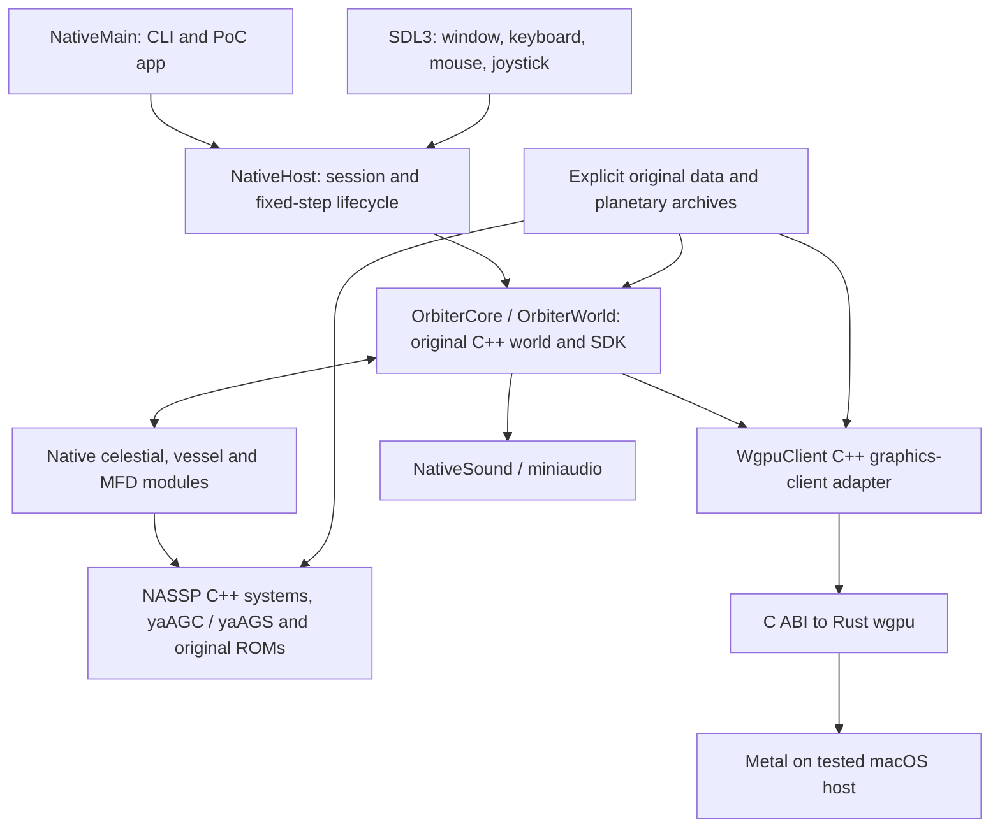

# Architecture and portability boundaries

The running native demo retains the original C++ world, spacecraft systems and
guidance emulators. Rust implements the new graphics backend. A Rust simulation
rewrite is a research proposal, not the architecture of the validated demo.

## Runtime path

[`PortableChecks.cmake`](../orbiter/cmake/PortableChecks.cmake) constructs shared
`OrbiterCore`; [`NativeWorld.cmake`](../orbiter/cmake/NativeWorld.cmake) links the
original body, rigid-body integrator, planet, vessel, terrain, camera and SDK
implementation with the native host. [`NativeMain.cpp`](../orbiter/Src/Orbiter/NativeMain.cpp)
provides headless and windowed scenario execution. Tests can instead call the
host directly and own every counted step.

[`NativeHost.cpp`](../orbiter/Src/Orbiter/NativeHost.cpp) owns native session
initialization, module callbacks, stepping, cockpit/MFD presentation and save
shutdown. World state remains coupled to original process-wide core state;
this baseline does not establish multiple independent concurrent worlds or a
thread-safe simulation API. Isolated runs use fresh processes and runtimes.

## Host and SDK compatibility

Platform services under [`Src/Orbiter/Platform`](../orbiter/Src/Orbiter/Platform)
provide dynamic loading, paths/VFS, SDL input, audio and timing. Original addon
source is compiled against the native SDK. Windows-sized integer/resource and
pointer conventions require explicit compatibility support. Existing MSVC
Windows addon DLLs cannot be loaded into an arm64 macOS process; recompilation
and source compatibility are the boundary.

The native host supports the exercised 3D cockpit, bitmap resources, FDAI,
DSKY, X-pointers and Orbit/Surface instruments. It does not certify the entire
legacy Windows launchpad, dialog system, 2D panels or all third-party plugins.
SDL synthetic lifecycle tests cover delivery/isolation/release/focus behavior;
they do not calibrate a physical joystick or prove an unmeasured human command.

`StartPaused = TRUE` now follows the original initialization sequence: one
initial step (command-line fixed step, then configured fixed step, then 0.01 s
fallback) followed by pause. An interactive fixed-1/60 launch is consequently
at 1/60 simulated second when inspection begins. Manual-step comparison drivers
require `FALSE` before launch and count step 1 themselves. See
[the regression and timing record](../orbiter/docs/native-v9-startpaused.md).

## NASSP source and external build policy

[`NativeNassp.cmake`](../orbiter/cmake/NativeNassp.cmake) and
[`NativeNasspManifest.cmake`](../orbiter/cmake/NativeNasspManifest.cmake) use the
locked upstream source/include lists while supplying native linkage and platform
selection outside NASSP. This avoids upstream CMake treating every 64-bit host
as x64 and detecting OpenOrbiter from `lua.dll`. Fourteen exports are verified;
three modules still use upstream VC2017 XML source-list fallback.

Native source substitutions implement input, sound events and FDAI rendering.
Native bitmap resources replace Windows RC loading. Guidance/math code, ROMs,
checklists and original scenarios retain their recorded provenance. The separate
five-file persistence overlay fixes loader/throttle/cached CoG-PMI-fuel behavior;
it does not serialize the missing AGC timing/CDU FIFO state. No equation, ROM,
scenario or acceptance tolerance is adjusted to conceal a comparison failure.

The active adapted addon is `orbiter/Addons/NASSP`. `NASSP_DATA_DIR` selects a
separate pristine checkout of the same v9 commit, including ignored scenario,
texture and mission data. `ORBITER_TEXTURE_DIR` selects external planetary
archives. Runtime staging copies configuration/scenario data and links explicit
meshes, textures, modules and resources. It verifies provenance and rejects
foreign output bindings; it does not download data or discover another workspace.

## Graphics, audio and precision

[`WgpuClient.cpp`](../orbiter/Src/WgpuClient/WgpuClient.cpp) implements the native
graphics-client surface; [`rust/`](../orbiter/Src/WgpuClient/rust) builds through
Corrosion with the tracked Cargo lockfile. The C ABI separates renderer ownership
from the C++ SDK. The tested backend is Metal; wgpu backend availability alone
is not evidence of working Windows or Linux native mission builds.

The sunlight correction ignores an individual opaque body whose center is
strictly behind the Sun ray origin. This preserves daylight for a landed Eagle
below the Moon's mean-radius datum, matching the bounded stock sunlit-side
case. Night, forward-body eclipse and limb regression cases remain covered.
It is a rendering visibility correction, not a planetary-radius or mission-state
change. Terrain/material/normal-map/partial-disc fidelity remains incomplete.

[`NativeAudio.cmake`](../orbiter/cmake/NativeAudio.cmake) builds the native
miniaudio service. It does not use the historical proprietary irrKlang runtime
for the native backend. Audio device probing is a separate manual executable;
the automated mixer tests do not establish every host's audible output.

Simulation remains the original double-precision C++ implementation. Saved
scenario tokens have less precision than live state: equal RPOS/RVEL/AROT tokens
do not establish equal full-precision trajectories. Compiler/FP policy and the
toolchain matter; tiny systems residuals and wall-time RNG/scheduling effects
are retained as evidence rather than removed through tuning.

## Patch removal and packaging

The [engine ledger](../orbiter/upstream/openorbiter-native.json) records 3967
unchanged files and 357 added/modified/omitted paths in this selected source
candidate, including 37 upstream omissions. The [NASSP ledger](../orbiter/upstream/nassp-v9/manifest.json)
records 93 adapted paths in eight behavioral groups plus a separate
publication-notice group. Each group names adoption/removal conditions. Reconstruct only against the exact pin; apply all nonempty numbered
patches in order. Regeneration must preserve the separate group 08 boundary;
see [the two-stage procedure](../orbiter/docs/upstream-native-adoption.md).

These inventories describe the total inherited port, not merely the small engine
update from `4137930` to `bd1d101` (one upstream XRSound CMake argument-order
change). Replacing a hook requires equivalent behavior plus its regression
coverage. Upstream acceptance has not been negotiated or certified.

The tested isolated QA `.app` is ad-hoc signed, uniquely registered and bound to
local build libraries. It is a QA launcher, not a relocatable signed distribution.
CLI reproduction below avoids reliance on that local bundle. Multi-OS packaging,
dependency notices, runtime relocation, code signing and release workflows need
separate validation before publishing binaries.
